<!-- markdownlint-disable MD033 MD045 MD041 -->

**You ought to write your own code. When utilizing AI for code generation, you must engage in critical thinking rather than relying on AI to think on your behalf. Failing to do so leaves you unaware of what your code actually does, resulting in disastrous implications for future maintainability.**

    
    
     
    

👋 Welcome to my GitHub profile!

🧭 I'm from China—**锐冰** is my Chinese name, and **SharpIce** is my English name.

⚡️ I'm an open-source loving independent developer and CG artist. I love cute things and artwork. Most of what I do comes from interest, purely powered by love.

## 🛠 Tech Stack

### Professional / Intermediate

- OS: Linux
- Base: CI/CD, Git
- Languages: TypeScript, JavaScript
- Frameworks: Nuxt.js, Vue.js, Node.js

### Competent / Familiar

- Blender

### Newbie

- C#, Kotlin
- Reverse engineering (I use it to adapt to some black-box applications)

### Grave Property

- Lua, Java, Python
- TailwindCSS, UnoCSS

## 💬 Find Me At

- [My Website](https://avali.top)
- Discord: `.sharpice` **(Note the period at the beginning)** or [click here to discord app](https://discord.com/users/650534063492431891)

## ✏️ Roadmap

|                                                                  Plan                                                                  |     Status      |
| :------------------------------------------------------------------------------------------------------------------------------------: | :-------------: |
| [Argon Nexus Center(My personal website, blog, fictional worldview wiki, and novels)](https://github.com/SharpIceX/Argon-Nexus-Center) | 🟢 In Progress  |
|                                         [Nuxt Nexus](https://github.com/SharpIceX/nuxt-nexus)                                          | 🟡 Following Up |

## 🔐 Verification Fingerprints

### JAR Signing (KeyStore)

- KeyStore SHA-1: `0F:68:6D:99:D2:17:BC:4F:AF:29:61:F1:28:EA:20:E5:C0:DC:F5:F8`
- KeyStore SHA-256: `98:53:9C:BB:1C:C6:D7:E9:70:C7:4A:AA:E2:E7:F7:90:3F:66:85:21:5B:07:6A:7E:20:E4:5F:FD:29:A4:87:2C`

### GnuPG / PGP

- Fingerprint: `8530 B69C 80AD 4837 EAA6  D194 D701 8CC9 2444 C7B0`
- Public Key: [github.com/sharpIceX.gpg](https://github.com/sharpIceX.gpg)
